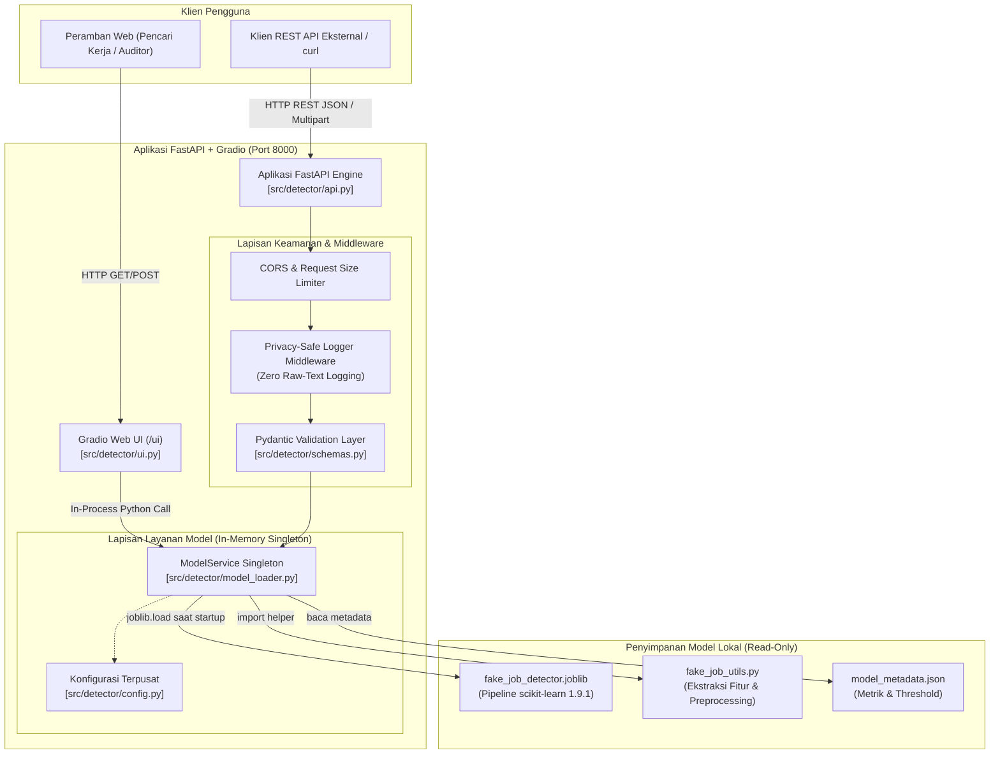
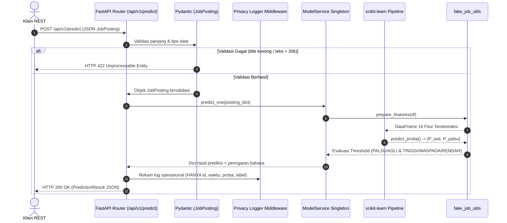
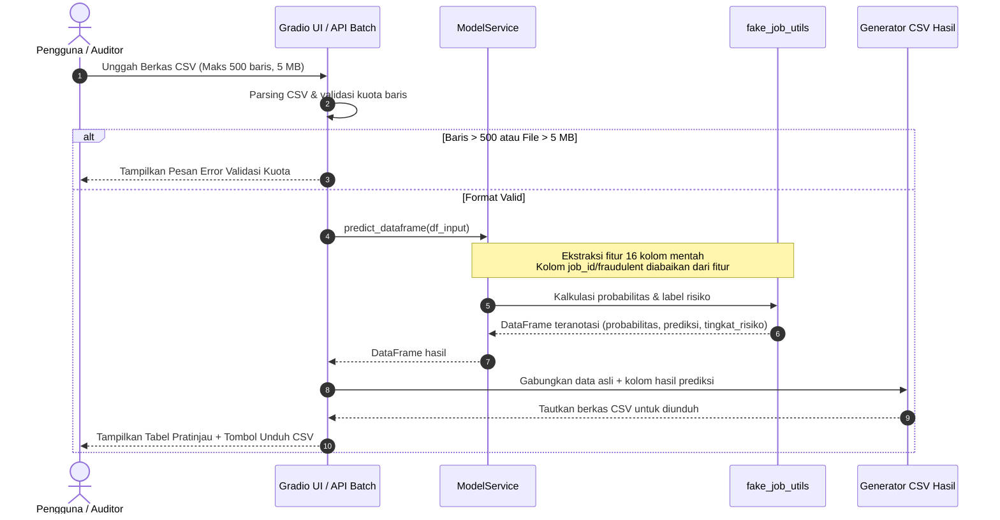

# Desain Arsitektur Sistem — Fase 2 (System Design)
**Proyek:** Sistem Cerdas Deteksi Penipuan Lowongan Kerja Palsu (Fake Job Detector)  
**Dokumen:** `docs/02-design/architecture.md`  
**Versi:** 1.0  
**Status:** Siap Ditinjau (Phase 2 Review)  
**Acuan SRS:** `docs/01-requirements/SRS.md` (FR-01 s/d FR-10, NFR-01 s/d NFR-08)  

---

## 1. Ikhtisar Arsitektur (*Architectural Overview*)

Sistem Fake Job Detector dirancang dengan pendekatan **Monolitik Modular Terpadu (*Integrated Modular Monolith*)**, di mana backend REST API berkinerja tinggi (FastAPI) dan antarmuka web interaktif (Gradio) berjalan dalam **satu proses tunggal** (*single process*) menggunakan ASGI server Uvicorn.

Pendekatan ini dipilih untuk:
1. Memaksimalkan efisiensi memori (model ML berukuran ~70 MB hanya dimuat satu kali ke RAM).
2. Memudahkan proses kontainerisasi dan *deployment* satu perintah tanpa dependensi eksternal yang rumit.
3. Menjamin latensi inferensi yang sangat rendah ($< 1$ detik) karena UI dan API mengakses layanan model dalam memori yang sama.



---

## 2. Struktur Modul & Tanggung Jawab Komponen

Seluruh kode aplikasi berada pada paket `src/detector/`. Struktur modular dipisahkan berdasarkan tanggung jawabnya (*Separation of Concerns*):

| Modul Berkas | Tanggung Jawab Utama | Pemenuhan Kebutuhan |
|---|---|---|
| `config.py` | Pengelolaan konfigurasi berbasis environment variables (`MODEL_DIR`, `MAX_BATCH`, `MAX_TEXT_LEN`, `LOG_LEVEL`), resolusi direktori absolut, dan konstanta penafian hukum. | FR-07, NFR-02 |
| `schemas.py` | Skema validasi Pydantic v2 untuk payload request/response API, sanitasi string, penegakan batas panjang karakter, validasi tipe biner, dan serialisasi JSON. | FR-03, FR-04, FR-05, FR-06, NFR-02 |
| `model_loader.py` | Implementasi `ModelService` berbasis pola Singleton (`@lru_cache`). Menangani pemuatan bundle `.joblib`, impor runtime `fake_job_utils`, penegakan 16 raw features, dan kalkulasi risiko berjenjang. | FR-02, NFR-01, NFR-04 |
| `api.py` | Inisialisasi FastAPI, manajemen *lifespan* (startup model preloading), penanganan error global (422, 503, 500), middleware *zero-raw-text logging*, routing endpoint REST, dan mounting Gradio UI. | FR-03, FR-04, FR-05, FR-09, NFR-01, NFR-03, NFR-07 |
| `ui.py` | Perancangan antarmuka Gradio Blocks (Beranda, Cek Lowongan, Cek Banyak CSV, Pusat Edukasi, Tentang Model), pemetaan visual warna risiko ramah aksesibilitas, dan pengelolaan unduhan berkas CSV hasil. | FR-01, FR-07, FR-08, FR-10, NFR-08 |
| `frontend/` *(CR-2026-11-05-02)* | SPA antarmuka pengguna modern berbasis React.js + Tailwind CSS + Lucide Icons yang mengonsumsi FastAPI REST API secara decoupled atau di-serve statis; mendukung deployment mandiri (Vercel/Netlify/Docker). | FR-01, FR-07, FR-08, FR-09, FR-10, NFR-08 |
| `api.py` (Assistant) *(CR-2026-11-05-03)* | Layanan percakapan interaktif Asisten AI Gemini (`POST /api/v1/assistant/chat`) untuk konsultasi keamanan rekrutmen kerja dan verifikasi pesan mencurigakan. | FR-01, FR-07, NFR-03 |

---

## 3. Alur Inferensi Sistem (*Inference Workflows*)

### 3.1 Alur Prediksi Lowongan Tunggal (`POST /api/v1/predict`)


### 3.2 Alur Prediksi Batch CSV (`POST /api/v1/predict/batch` & Gradio UI)


---

## 4. Keamanan, Privasi, & Manajemen Beban (*Security & Privacy Architecture*)

### 4.1 Kebijakan Privasi Ketat: *Zero Raw-Text Logging* (NFR-03)
Sistem mematuhi regulasi perlindungan data pribadi dengan prinsip *data minimization*:
1. **Middleware Logging**: Diterapkan middleware kustom pada FastAPI yang mencegat setiap request dan response.
2. **Atribut Log yang Diizinkan**:
   - `request_id` (UUIDv4 unik per request).
   - `timestamp` (Waktu UTC).
   - `method` & `path` (mis. `POST /api/v1/predict`).
   - `status_code` (mis. `200`, `422`, `503`).
   - `duration_ms` (Latensi pemrosesan).
   - `prediction_label` (mis. `PALSU`).
   - `probability` (mis. `0.8672`).
   - `risk_level` (mis. `TINGGI`).
3. **Atribut Log yang DILARANG KERAS**:
   - Isi teks `title`, `description`, `company_profile`, `requirements`, kontak email, nomor telepon, atau data input mentah pengguna.
   - Tidak ada payload dump pada console log maupun file audit saat mode operasional.

### 4.2 Pencegahan Serangan DoS & Validasi Batas Input (NFR-02)
- **Ukuran String:** `title` dibatasi $\le 500$ karakter; seluruh field teks panjang lainnya (`description`, `company_profile`, `requirements`, `benefits`) dibatasi $\le 20.000$ karakter per kolom.
- **Ukuran Batch:** Maksimal 500 item per panggilan API batch atau per berkas CSV.
- **Ukuran Berkas:** Maksimal 5 MB untuk unggah CSV.
- **Eksekusi Dini:** Validasi dilakukan di lapisan terluar (Pydantic / FastAPI request stream) sehingga request yang tidak valid langsung ditolak dengan status HTTP 422 tanpa membebani thread inferensi CPU.

### 4.3 Keamanan Deserialisasi Model (NFR-07)
- Fungsi `joblib.load` hanya dijalankan terhadap berkas lokal terpercaya yang dikonfigurasi melalui variabel lingkungan `MODEL_DIR` dan `MODEL_FILE`.
- Tidak ada fitur pengunggahan atau pemuatan file model dari sisi pengguna atau klien eksternal.

---

## 5. Strategi Kinerja & Eksekusi Asinkron (NFR-01)

1. **Singleton Model Lifecycle:** Objek `ModelService` dibuat secara *lazy-singleton* dan di-cache dalam memori. Saat aplikasi FastAPI dinyalakan (*lifespan event startup*), model langsung di-load sehingga tidak ada latensi tambahan (*cold start penalty*) pada panggilan prediksi pertama pengguna.
2. **Threading & Concurrency:** Inferensi model berbasis CPU NumPy/scikit-learn bersifat sinkron dan komputasional. Endpoint FastAPI didefinisikan sebagai fungsi standar (`def` bukan `async def`) agar FastAPI secara otomatis mengeksekusi inferensi pada *external threadpool* internal (AnyIO), mencegah terjadinya pemblokiran (*blocking*) pada event loop utama ASGI server.
3. **Latensi Terukur:**
   - Prediksi tunggal: rata-rata 10–50 ms ($< 1{,}0$ detik).
   - Prediksi batch 500 baris: rata-rata 2–5 detik ($< 15{,}0$ detik).

---

## 6. Penanganan Galat Sistem (*Error Handling Strategy*)

Sistem mengadopsi format pesan galat JSON standar untuk seluruh endpoint REST API:
```json
{
  "detail": "Pesan deskriptif penyebab kegagalan",
  "code": "KODE_ERROR_TERSTRUKTUR",
  "warnings": []
}
```

| Kode Status | Kondisi Terjadinya | Tindakan Sistem |
|---|---|---|
| **422 Unprocessable Entity** | Validasi input gagal (kolom wajib kosong, teks melebihi 20.000 char, kuota batch $> 500$). | Mengembalikan daftar field yang salah secara spesifik tanpa menjalankan model. |
| **503 Service Unavailable** | Berkas model tidak ditemukan atau gagal dimuat saat startup. | Mengembalikan status bahwa layanan klasifikasi sedang tidak siap (*ModelNotAvailable*). |
| **500 Internal Server Error** | Kesalahan tak terduga (*unhandled exception*) dalam proses kalkulasi. | Menangkap error, mencatat exception ID di log server, dan menyajikan pesan generik tanpa membocorkan stack trace internal. |

---

## 7. Pemetaan Kebutuhan ke Komponen Arsitektur

| ID Kebutuhan SRS | Komponen Arsitektur Penanggung Jawab | Cara Pemenuhan |
|---|---|---|
| **FR-01** | `ui.py` | Form input Gradio menyediakan 16 atribut fitur model mentah. |
| **FR-02** | `model_loader.py` & `fake_job_utils.py` | Kalkulasi probabilitas dan penetapan label risiko berjenjang 3 level. |
| **FR-03** | `api.py` & `schemas.py` | Endpoint `POST /api/v1/predict` menerima dan memvalidasi `JobPosting`. |
| **FR-04** | `api.py` & `schemas.py` | Endpoint `POST /api/v1/predict/batch` memproses list JSON & file CSV. |
| **FR-05** | `api.py` | Endpoint `GET /health` dan `GET /api/v1/model-info`. |
| **FR-06** | `schemas.py` | Validasi kewajiban `title` & `description`, default value kolom opsional. |
| **FR-07** | `config.py`, `ui.py`, `api.py` | Menampilkan teks penafian resmi pada header UI dan response warnings API. |
| **FR-08** | `ui.py` | Generator unduh berkas CSV teranotasi hasil prediksi pada Tab 2 Gradio. |
| **FR-09** | `api.py` | `gr.mount_gradio_app(app, blocks, path="/ui")` dalam satu server ASGI. |
| **FR-10** | `ui.py` | Tombol preset contoh data sah & mencurigakan yang mengisi form instan. |
| **NFR-01** | `model_loader.py` & `api.py` | Singleton pattern & background threadpool execution menjamin latensi $< 1$ dtk. |
| **NFR-02** | `schemas.py` & `config.py` | Batas teks 500/20.000 char, batch 500 baris, file 5 MB. |
| **NFR-03** | `api.py` | Middleware custom logging yang mengecualikan teks mentah request body. |
| **NFR-04** | `model_loader.py` & `Dockerfile` | Kunci runtime `scikit-learn==1.9.1` sesuai `models/current/requirements.txt`. |
| **NFR-05** | Keseluruhan paket `src/detector/` | Struktur modular memudahkan unit testing dengan target coverage $\ge 80\%$. |
| **NFR-06** | `Dockerfile` & `Makefile` | Multi-stage lightweight packaging berbasis `python:3.11-slim` non-root. |
| **NFR-07** | `api.py` & `ui.py` | Sanitasi input, safe joblib loading dari path lokal terdaftar, pembatasan 500. |
| **NFR-08** | `ui.py` | Desain badge UI menyandingkan teks eksplisit dan palet warna kontras. |

---

## 8. Definition of Done — Fase 2 (Arsitektur)
- [x] Topologi sistem satu proses (FastAPI + Gradio) terdokumentasi lengkap.
- [x] Tanggung jawab seluruh modul dalam `src/detector/` terpetakan jelas.
- [x] Diagram urutan (*sequence diagrams*) untuk alur inferensi tunggal dan batch tersedia.
- [x] Kebijakan privasi *zero-raw-text logging* dan mitigasi DoS dirancang detail.
- [x] Seluruh FR dan NFR memiliki komponen arsitektur penanggung jawab yang terverifikasi.
